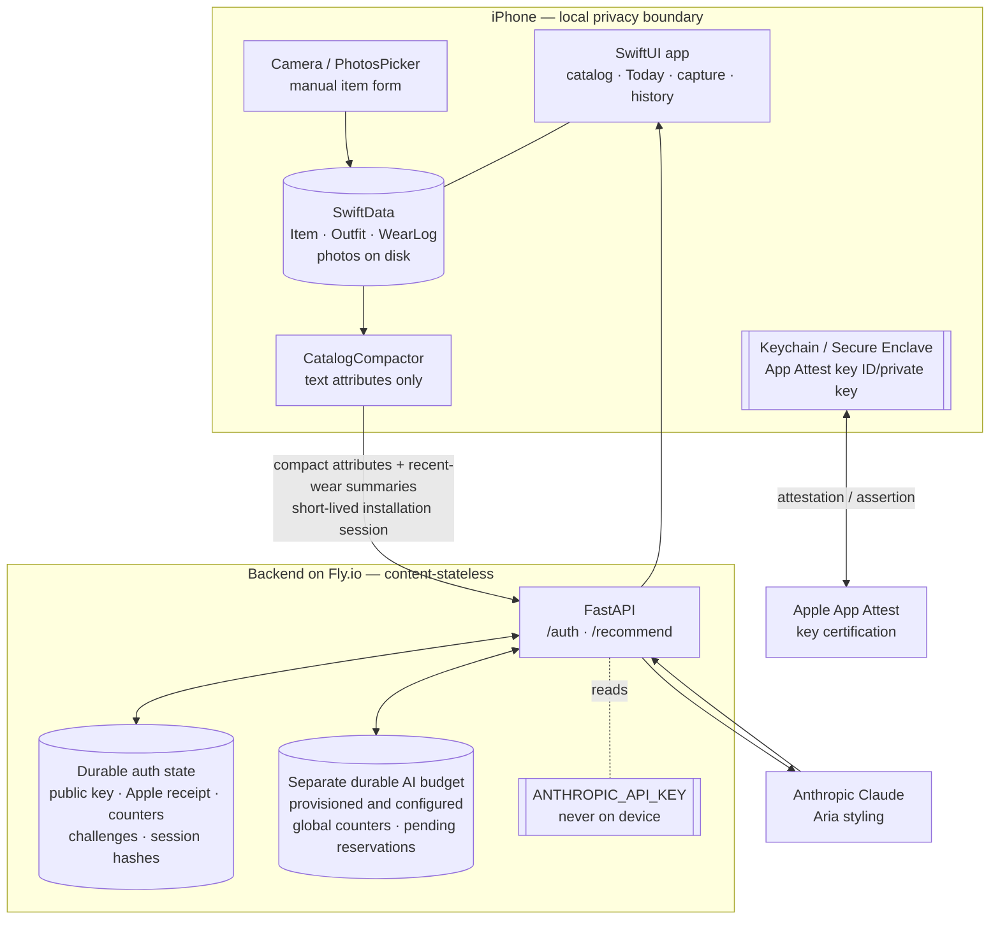
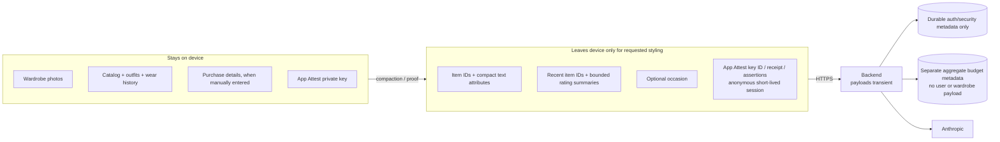
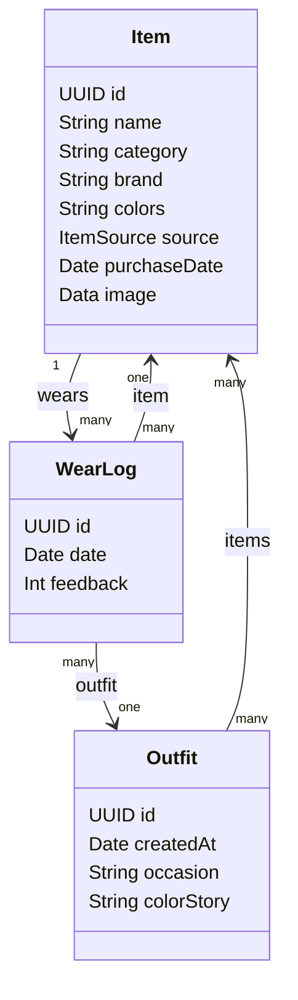
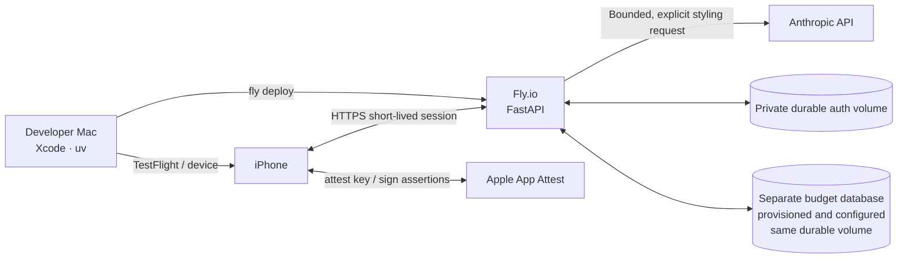

# Architecture

Wardrobe Stylist is a **local-first, privacy-first** personal app. Public v1 builds a wardrobe from
manual entries and user-selected photos, keeps the catalog on the iPhone, and offers optional AI
outfit styling. A thin, content-stateless backend holds the Anthropic API key and persists only the
minimum App Attest authentication/security metadata and anonymous aggregate AI-budget accounting.

Current runtime: **Fly v14 retains the enabled bounded AI pilot** and accepts App Attest
categories `2,4`. Independent configuration verification passed at `2026-09-12T06:36:24Z`, with
the exact image, original resources, keys, policy and intact below-warning ledger preserved.
The full v14 operations review remains pending. The earlier v13 activation review and first
protected TestFlight call remain retained evidence. See the
[compatibility checkpoint](app-store/internal-testflight-runbook.md#app-store-compatibility-deployment--12-september-2026).

Historical 8 September setup: **Fly v12 had AI styling disabled**. The configuration deployment retains source
`d2866a2375dd4795f40a3ab13d273ed138cedd7e`, the scanned immutable image, original Machine and
encrypted volume. Independent post-review passed at `2026-09-08T09:32:49Z`: the approved private
policy and new provider key are applied, the serving UID reads the existing v2 ledger with zero
current-month state, and the disabled guard returns 503. The selected Sonnet request passed
automatic evaluation and received qualitative owner acceptance. First provisioning, provider
workspace/cap/email settings, sufficient prepaid credit and public-capacity setup are complete.
Preserve the ledger and approved limits; do not initialize or reset it again. No paid AI call was
made during deployment or verification. Provider alert delivery remains unproven and billing-feed
reconciliation remains unresolved. The [10 September release plan](release-plan.md) uses daily
owner cost review for the small pilot and defers external monitoring. The
[10 September beta-only review and internal distribution](app-store/internal-testflight-runbook.md#build-7-distribution--2026-09-10)
are complete. Handoff and scoped local-beta QA passed on 11 September; v13 activation is complete; protected-device styling proof passed on 12 September; public release remains open;
refresh operations evidence for later changes and their declared milestone.
The ordinary budget diagnostic now uses the service identity; live read-only verification on
9 September returned OPEN `styling-disabled` on the unchanged v12 runtime and existing ledger.
See the [launch-readiness follow-up](app-store/internal-testflight-runbook.md#launch-readiness-follow-up--2026-09-09),
[approved disabled setup checkpoint](app-store/internal-testflight-runbook.md#approved-disabled-budget-setup--2026-09-08)
and [release backlog](app-release-backlog.md). Retained v10/v11 evidence describes historical
archive and disabled-preparation checkpoints.
[PR #41](https://github.com/tzehon/wardrobe-stylist/pull/41) records source publication, required
checks, Codex review, and merge state.

Public v1 does not connect to Google, read Gmail, import purchase receipts, or require a human
account. The earlier read-only Gmail/receipt-import implementation remains only in Git history and
explicitly historical setup documents; it is not part of the active v1 architecture.

- [System overview](#system-overview)
- [Privacy and trust boundaries](#privacy-and-trust-boundaries)
- [Anonymous backend authorization](#anonymous-backend-authorization)
- [Manual and photo catalog](#manual-and-photo-catalog)
- [Daily recommendation flow](#daily-recommendation-flow)
- [Data model](#data-model)
- [Tech stack](#tech-stack)
- [Deployment topology](#deployment-topology)
- [Historical build 4 clean-install transition](#historical-build-4-clean-install-transition)
- [Historical Gmail implementation](#historical-gmail-implementation)

## System overview

The **iPhone** owns the wardrobe and user experience. **Apple App Attest** certifies one genuine
installation for optional connected styling. When enabled, the developer backend proxies a
minimized request to the **Anthropic API** and keeps no wardrobe or model payload after request
processing. Fly v14 retains the enabled provider-call path under the existing approved budget policy.
The first protected TestFlight styling result passed on 12 September.



## Privacy and trust boundaries



| Data | Where it lives | Leaves device? |
|---|---|---|
| Catalog, photos, outfits, wear history | SwiftData + on-disk storage | No, except minimized styling fields below |
| Wardrobe photos | Device-local catalog | No in v1 styling |
| Purchase date/price/currency, if entered | Device-local catalog | No in v1 styling |
| App Attest private key | Secure Enclave | Never extractable |
| App Attest key ID, opaque Apple attestation receipt, counters and session metadata | Keychain + backend auth store | Yes, security/authorization only |
| Compact item attributes and recent-wear summaries | Backend → Anthropic for a requested suggestion | Yes, request lifetime only in the developer application |
| Optional occasion | Backend → Anthropic for that request | Yes |
| Monthly AI charge/admission counters and random pending-reservation metadata | Separate private backend budget ledger | Generated on the backend; no installation or wardrobe identifiers |

The anonymous installation identifier is not a Wardrobe, Apple, or Google account. It survives
normal app updates but is recreated after reinstall, migration, or restore. The approved retention,
deletion, logging, and snapshot requirements live in the
[APP-009 data lifecycle and logging policy](app-store/app-attest-data-lifecycle-policy.md). Its
compliance table distinguishes verified controls from open external evidence; architecture text
must not turn an unchecked target into a production claim.

## Anonymous backend authorization

Remote AI uses App Attest-backed, short-lived sessions without a login screen:

```mermaid
sequenceDiagram
    participant App as iOS app
    participant Apple as Apple App Attest
    participant API as Wardrobe backend
    participant DB as Durable auth store

    App->>API: Request one-time attestation challenge
    App->>Apple: Generate key; attest SHA256(challenge)
    Apple-->>App: Attestation object
    App->>API: Key ID + attestation object
    API->>API: Verify Apple chain, nonce, RP ID,<br/>environment and counter; iOS 27+ category/build
    API->>DB: Store public key + receipt + installation metadata
    API-->>App: Short-lived bearer session
    Note over App,API: Later, after expiry
    App->>API: Request assertion challenge
    App->>Apple: Sign canonical client data
    App->>API: Assertion + exact client data
    API->>DB: Atomically consume challenge and advance counter
    API-->>App: New short-lived bearer session
```

The production verifier requires the exact registered App ID prefix + bundle ID, App Attest
environment, key binding, nonce/signature, and monotonic counter. On iOS 27+, Apple appends signed
validation-category and bundle-version extensions; when present, both must match the configured
distribution categories (`2` TestFlight, `4` App Store) and explicit build allowlist. Their signed
absence is accepted for supported iOS 18–26 clients. Challenges are randomized, expiring,
purpose-bound, and single-use; counters advance atomically.

App Attest is a physical-device boundary. Simulator tests use an injected fake. If
`DCAppAttestService.isSupported` is false—or secure verification is offline—the app keeps the
local wardrobe and offline Demo Mode usable but does not mint an unauthenticated remote-AI
session.

## Manual and photo catalog

Users add an item manually, photograph a garment, or choose a photo with `PhotosPicker`, then
complete a bounded details form. `ImageProcessor` downscales the selected image and thumbnail for
device-local storage. The catalog UI reads SwiftData directly; no backend is involved.

- **Dynamic categories** derive sections from the stored items.
- **Browse** supports search, category filters, recent/name/brand sorting, favorites, archive, and
  deliberate deletion.
- **Images** prefer local photo data and otherwise show a category placeholder.
- **Detail/edit** exposes the item's user-entered attributes and validation errors.
- **History** stores accepted outfits and wear logs locally for anti-repeat behavior.

See [`ios/Wardrobe/Capture/`](../ios/Wardrobe/Capture),
[`ios/Wardrobe/Views/`](../ios/Wardrobe/Views), and
[`ios/Wardrobe/Models/`](../ios/Wardrobe/Models).

## Daily recommendation flow

The stylist agent **Aria** proposes a wearable, non-repeating outfit from the user's own catalog.
The deployed bounded pilot uses pinned `claude-sonnet-5` through one synchronous
Messages API call with Anthropic Python SDK `1.4.0`. Extended thinking is disabled, and strict forced
`propose_outfit` output is pinned to the evaluated 1,024 tokens. The configuration parser and
ledger retain broader safety bounds, but runtime admission and preflight reject any other
configured output limit or stylist default before budget storage/provider access. All automatic checks passed, followed by
owner qualitative acceptance with the numeric rubric explicitly left incomplete. Prompt
caching is off until production cadence supports reuse; evaluation can opt into a five-minute marker
on the static rubric and tool definition only. The app sends compact text attributes, recent-worn
IDs, bounded rating summaries, and an optional occasion. None of this payload enters either database.
The sequence below describes the enabled v14 pilot. Admission still fails closed if styling is
disabled or the existing budget cannot safely admit the request.

```mermaid
sequenceDiagram
    actor User
    participant App as iOS app
    participant API as FastAPI /recommend
    participant Budget as Durable global budget
    participant Aria as Pinned Claude Sonnet 5

    User->>App: Request a suggestion in Today
    App->>App: Compact catalog + recent-worn summaries
    App->>API: POST /recommend (short-lived App Attest session)
    API->>API: Validate input and operational size limits
    API->>Budget: Atomically reserve worst-case tokens + admission + slot
    Note over API,Budget: Disabled, exhausted, missing, or unsafe ledger fails closed
    API->>Aria: One strict forced tool call; no thinking or retries
    Aria-->>API: Outfit + alternates + rationale
    API->>API: Reject any ID absent from submitted catalog
    API->>API: Apply authoritative local schema bounds
    API->>Budget: Settle checked usage after validated success
    API-->>App: Validated suggestion
    App->>App: Resolve IDs to local items; render look
    User->>App: Wear this
    App->>App: Persist Outfit + WearLog
```

On device, `CatalogCompactor` builds the request, `WearHistory` derives recent-worn data, and
`OutfitRecommender` resolves returned IDs back to `Item`s. “Show me another” cycles returned
alternates without another network call. The last successful look is cached locally for the day;
if an explicit Restyle fails, the usable look remains visible with bounded retry feedback, and the
transient failure is not persisted in that cache. Weather, calendar context, and multi-agent
composition are deferred.

The strict provider schema omits unsupported array-length constraints; the existing shared schema,
Pydantic validation, and catalog-ID sanitizer remain authoritative. `/recommend` retains its Build 7
request/response shape. Operational admission caps separately bound the raw body to 128 KiB,
normalized request JSON to 32 KiB, catalog to 200 items, and each color to 64 characters. Larger
requests fail before an AI call using existing error handling. This backend-only migration does
not require Build 8.

The budget reserves the full Sonnet 1,000,000-token input-context ceiling at two micro-USD per
input token plus ten micro-USD per configured output token before each call; at 1,024 output
tokens this is US$2.010240. It does not rely on a local token estimate or resend a wardrobe for
token counting. Only a successful validated response with checked uncached usage can refund the
unused amount. Terminal failed output keeps its full charge; uncertain calls keep both charge and
concurrency slot across restarts and month boundaries until explicit owner recovery. No automatic
retry, timeout refund, or fresh-database recreation can reopen the approved allowance. The v2
ledger persists its model, unit, rate, and token-bound policy; old Haiku or mismatched storage
fails closed without an automatic upgrade. See
[AI spend controls](ai-spend-controls.md) for private provisioning, alerts, disable/recovery, and
the approved public-capacity review bounds and ongoing pilot checks. The
[release plan](release-plan.md) uses daily owner cost review for the small pilot and defers the
external monitoring prototype.

## Data model



The v1 schema contains only device-local `Item`, `Outfit`, and `WearLog` models; `ItemSource` is
`manual | photo`. The active public-v1 target does not link the earlier Gmail/account-owned schemas
and does not perform an in-place migration from the older Gmail-capable builds.

## Tech stack

| Layer | Technology |
|---|---|
| iOS UI | SwiftUI (iOS 18 deployment target) |
| Persistence | SwiftData; images via `.externalStorage` |
| Backend auth | DeviceCheck App Attest + short-lived anonymous installation sessions |
| Capture | UIKit camera bridge + PhotosPicker |
| On-device image work | UIKit/Vision where supported; device-bound paths are gated in tests |
| Backend | FastAPI + locked Anthropic SDK 1.4.0/httpx2; uv, Ruff, mypy, pytest |
| AI runtime | Enabled bounded pilot on v14; pinned Sonnet 5 “Aria”, strict forced tool, no thinking, cache off |
| Budget controls | Provisioned and configured; separate durable SQLite ledger with verified private policy and atomic global month/token/admission/concurrency limits |
| Tests | Swift Testing, UI tests, pytest, request-capture and release-artifact guards |
| CI | GitHub Actions |

## Deployment topology



- Fly secrets hold the workspace-scoped `ANTHROPIC_API_KEY`, all six approved private AI settings
  and the preserved App Attest session-signing secret. The key was transferred through hidden owner
  input without local secret persistence; rotation before its 8 October 2026 expiry is required. A shared
  `DEVICE_TOKEN` is not an acceptable public-client credential or rollback mechanism.
- The durable auth store contains Apple-certified public keys, opaque Apple attestation receipts,
  anonymous installation IDs, assertion counters, one-time challenges, hashed short-lived
  sessions, and coarse rate windows. It contains no wardrobe, prompt, or recommendation payload.
- The provisioned `/data/ai-budget/budget.sqlite3` stores only aggregate
  counters and random reservation metadata. Its private limits must match the approved runtime configuration.
  The v12 restart verified the existing ledger is readable without reset. The approved v13
  activation and enabled review passed on 12 September, preserving that ledger and policy.
  Continue the daily cost/response checks; residual Fly exposure remains and external monitoring is deferred.
  Every application process must use the same ledger on the verified single-Machine volume;
  independent per-replica budgets would not enforce a global ceiling.
- Backend auth state, logs, snapshots, deletion, and manual operations follow the
  [APP-009 lifecycle policy](app-store/app-attest-data-lifecycle-policy.md). Fly's fixed seven-day
  customer-visible stream and undisclosed provider-internal in-service retention are accepted and
  publicly disclosed. The monitored 25/28 August snapshots were later observed absent from the
  customer-visible list. The 10 September Build-7 pre-deletion snapshot's later disappearance and
  deletion-specific recovery evidence were not proven; on 2026-09-11 the owner waived only that
  evidence sub-gate for the Free Singapore v1 and accepted the residual risk. Pre-deletion snapshots
  remain ineligible for service recovery.
- Public v1 has no Google OAuth dependency or Gmail network route.
- The default `ai-launch` preflight requires the bounded budget to be enabled, ready, below its
  warning band, and free of pending requests. The explicit `internal-beta-ai-disabled` purpose
  requires verified disabled styling with an intact, below-warning, idle ledger and every other
  check passing. It reports beta-only eligibility and does not authorize AI or public submission.
  The historical configured-but-disabled v12 review returned OPEN `styling-disabled` under the default `ai-launch`
  purpose. The 10 September combined beta-only review passed; each later operations review
  requires fresh same-session manual inputs. The 9 September diagnostic correction connects as `wardrobe`,
  requires real/effective UID and GID 10001 before status inspection, and suppresses bytecode writes
  with `-B`. Live read-only verification passed without changing the runtime or ledger. The
  earlier 8 September `styling-budget-evidence-open` result remains historical evidence.
  The approved public-capacity file is installed and its configured band passed the post-review.
  Saved provider limits/notifications and sufficient credit do not prove alert delivery. The
  current daily owner-review path does not rely on that unproven delivery or require the deferred
  Fly monitor; variable hosting charges and detection delay remain explicit operating risks.
- The unchanged privately recorded image used by v11/v12 is the disabled recovery reference.
  The v12 restart verified compatibility with the existing ledger and limits without initialization
  or reset. Pre-budget v10 must not become a normal rollback target after cutover. Recovery must
  preserve and reverify the same ledger, policy and liability.
  See [AI spend controls](ai-spend-controls.md) for the remaining operational gates.

## Historical build 4 clean-install transition

Build `1.0.0 (4)` was intentionally fresh-install-only. The owner approved discarding the earlier
local wardrobe and adding items again. The installed development build disconnected Google and
deleted local data, but predated the server-deletion UI. A read-only aggregate production check
found zero installations, sessions, and pending challenges before it was uninstalled, so no live
production identity required deletion. This is evidence for that retired build only, not a general
server-deletion bypass.

Build 4 was later installed only from processed TestFlight as a clean app and enrolled one new
anonymous App Attest installation. Physical QA made it non-promotable. Current candidate status,
clean-install requirements, and retained evidence live in the [release backlog](app-release-backlog.md)
and [internal TestFlight runbook](app-store/internal-testflight-runbook.md); never treat this
transition as upgrade/migration support.

## Historical Gmail implementation

Earlier internal builds implemented optional, GET-only Gmail receipt import, on-device candidate
filtering, `/extract`, and background receipt sync. Those product paths, schemas, dependencies,
configuration values, and backend route are removed from active v1 source.

The historical design remains subject to a strict no-write rule until removed. Reintroducing it in
a later release would require a fresh product/privacy review, Google restricted-scope work as
applicable, updated public pages and App Privacy answers, archive checks, and a new TestFlight
candidate. See [`google-setup.md`](google-setup.md) and
[`gcp-oauth-production-sequence.md`](gcp-oauth-production-sequence.md) for historical context only.
